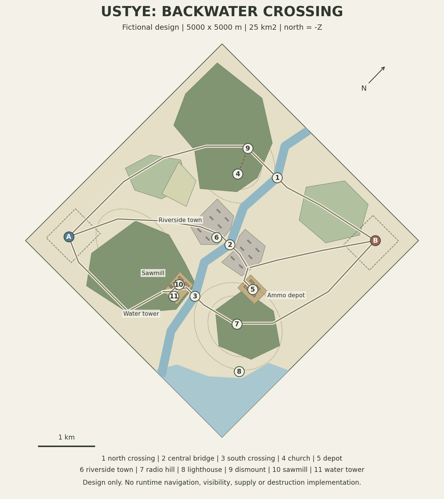

# Ustye: Backwater Crossing

Status: **schematic design only**. This is a reproducible map proposal, not a loadable map package or a playable 5 km level. No navigation, sensing, balance or frame-time result is claimed.



- [Editable overview](overview.svg)
- [Offline layer viewer](viewer.html): open in a browser, no server or external resources required.
- [Source plan](layout.json): versioned design data, meters, stable feature IDs.
- [Derived route measurements](routes.json)
- [Comparison and review notes](review-notes.md)
- [Shared concept brief](../map-concept-brief.md)

## Landscape and identity

A fictional coastal landscape inspired by Lubin and Wapnica on Wolin and the wider Swina estuary. Municipal sources describe the lagoon-facing hill viewpoint and church. They support the atmosphere and landmark ideas, not this map's exact geometry.

Sources:
- [Municipality of Miedzyzdroje, Lubin hill viewpoint](https://miedzyzdroje.pl/strona/grodzisko-sredniowieczne).
- [Official Swinoujscie visitor portal, estuary and lighthouse](https://visit.swinoujscie.pl/en/).

The river, bridges, panel estate, roads, stockpile, timber yard and deployments are invented and rearranged. The first graybox should use clear overcast lighting. Autumn olive woods, straw fields, gray concrete and a pale coastal horizon define the art direction. Low sun and night presets follow readability testing.

The square is 5000 m per side, 25 km2 including water. It is drawn diagonally, not clipped to a half-area diamond. Origin is northwest; +X east, +Z south, +Y up, north = -Z. This matches the engine's ground-plane convention. Competing south-origin/north-positive plans require coordinate conversion before reuse.

## Combined design

| Place | Purpose |
|---|---|
| 1, northern service crossing | Alternative road and a wheeled supply fallback when the central bridge closes |
| 2, central road bridge | Fast central access, exposed enough to justify recon |
| 3, southern service crossing | Narrower coastal bypass; future traffic and speed-cost test |
| 4, church ridge | Western observation candidate, with forest and terrain limits still to be tested |
| 5, warehouse | Command-vehicle target in an early mission; finite stockpile in a later supply experiment |
| 6, riverside panel town | Six panel blocks on each bank, with the central bridge joining the two districts; later infantry and staged destruction |
| 7, radio hill | Different observation opportunity on the other bank |
| 8, lighthouse | Coastal orientation, not an all-map vision reward |
| 9, dismount | On the northern road, about 493 m of final foot travel from the church |
| 10, sawmill | Forest-edge clearing near the southern river bank, separate from the depot, with sheds, log stacks and a road entrance |
| 11, water tower | Sawmill observation-deck candidate, 18 m above local ground; actual occupancy, access and LOS are future work |

The town surrounds the central crossing instead of sitting entirely on the east bank. Buildings are set back at least 20 m from the proposed river banks. Both districts have open street approaches to the bridge. The river separates neighborhoods without turning the town into an island or forcing every route through one crossing.

The sawmill occupies a clearing at the edge of the southern forest. Its bank-side setting is a visual and tactical choice, not an extraction or water-resource mechanic. An access spur joins the southern road. A separate spur serves the depot. Neither spur counts as a fourth cross-river route. The water tower has a proposed accessible platform; the radio hill can retain a mast as a landmark without making an antenna automatically occupiable.

The terrain remains asymmetric. The central road approaches measure about 3064 m from A and 2884 m from B, a 180 m difference, or about 22 seconds at the assumed constant 30 km/h. This compares only road distance. Cover, route costs, hill access and effective first-fire positions still need side-swapped gameplay tests. The northern and southern bypasses deliberately have different approach advantages.

Borrowed design ideas are recorded explicitly in the comparison notes. No competing geometry was copied into this coordinate system.

Dense forest is intended for foot movement off-road, with explicit road corridors for vehicles. Sparse woodland, water and forest sensing are proposed surface rules, not working engine behavior. Open fields remain traversable: the three plotted roads are examples, not compulsory lanes.

All three initial crossings are proposed to accept ground vehicles. They vary in deck width and route exposure. Fords, swimming and vehicle-specific depth limits are postponed, so one lost bridge does not silently isolate wheeled supply. Deck endpoints are explicit and checked against river centerline and roads. They are not runtime support surfaces.

## Travel estimates

All vehicle polylines start at entry A and end at entry B. The foot polyline starts at the dismount point and ends at the church. These are shared, declared endpoints, not mixed boundary-to-boundary and deployment-to-objective distances.

| Route | Length | Constant-speed estimate |
|---|---:|---:|
| Central road | 5948 m | 11.9 min at 30 km/h |
| Northern bypass | 6645 m | 13.3 min at 30 km/h |
| Southern bypass | 7067 m | 14.1 min at 30 km/h |
| Final foot approach | 493 m | 4.9 min at 6 km/h |

These omit every cost listed in `timing_assumptions.omits`. They are not in-game measurements. First contact is not half a full-route time: actual start positions, observation range, terrain, identification and actions matter. With two units following the central polyline toward each other at 30 km/h, the purely geometric opportunity to come within 2 km is about 3.9 minutes. This does not establish LOS or actual detection.

## Missions on the same terrain

1. **Recon strike:** inspect the depot and attack a command vehicle through a chosen crossing. This can be the first vehicle-only scenario once the terrain is playable.
2. **Meeting engagement:** equal compositions, 20 to 40 units per side, with side-swapped deployments. Test terrain advantage with identical definitions before attributing results to faction balance.
3. **Screen and withdraw:** forward defenders observe and delay, evacuate finite depot stock and withdraw across the river. Survival, evacuation and delay all contribute. This is a later scenario requiring objective, supply, smoke and bridge-lifecycle work. It does not require a separate physical map.
4. **100 versus 100 stress probe:** same landscape with separate spawn/order rules. This measures load; it is not the normal mission or proof of PvP fairness.

## Risks and implementation order

- Three crossings may still dominate every match. Test open-ground maneuver between approaches, multiple observation positions and central bridge closure before adding more bridges.
- The east-bank depot can favor the northeast force. Compare time to effective cover and observation from both sides with the same units.
- Synthetic hills and the DG-W polygon are design hypotheses. No visibility fans, guaranteed blind areas or fixed forest sight ranges are certified.
- A five-minute final foot leg may still feel long. Test transport convenience and shorten the drop-off distance if it creates idle waiting.
- The coast needs a route or supply purpose. Scenic water alone does not justify unused playable space.
- 5 km navigation scaling is a prerequisite. Current portal capacity and dense per-class component storage are documented in [tank-battle follow-ups](../../tank-battle-follow-ups.md). Raising constants alone is not the solution.
- Roads and crossings have no traffic or clearance guarantees from this diagram. Vehicle avoidance and bridge queues need runtime work.

Implementation order: navigation scale and memory validation; surface/movement rules and crossing links; terrain/structure graybox and actual LOS checks; initial vehicle scenario; gameplay smoke; infantry and containers; supply/withdrawal objectives; selected final art and staged destruction.

Forest, water, smoke, elevated building observers, supplies and destruction must use authoritative world state and recipient knowledge. The client view must not invent those rules. Debris can be cosmetic, but a destroyed building's gameplay geometry needs explicit simulation state.

## Regenerate and check

SVG, HTML, route measurements and validation need Python 3 standard library only:

```sh
python3 -B tools/map-authoring/ustye_plan.py
python3 -B tools/map-authoring/ustye_plan.py --check
python3 -B -m unittest discover -s tools/map-authoring -p 'test_*.py' -v
```

The optional PNG preview needs Matplotlib in the authoring environment:

```sh
python3 -B tools/map-authoring/ustye_plan.py --png
```

The checks catch off-river bridges, mismatched visual markers, decks too short to reach the banks, roads crossing outside declared decks, inconsistent route endpoints, disconnected access spurs, buildings across streets or river setbacks, buildings outside their districts, bad coordinates, bay crossings and stale generated text/vector artifacts. They do not replace raster surface, collision, slope, LOS or pathfinding tests in the engine.
