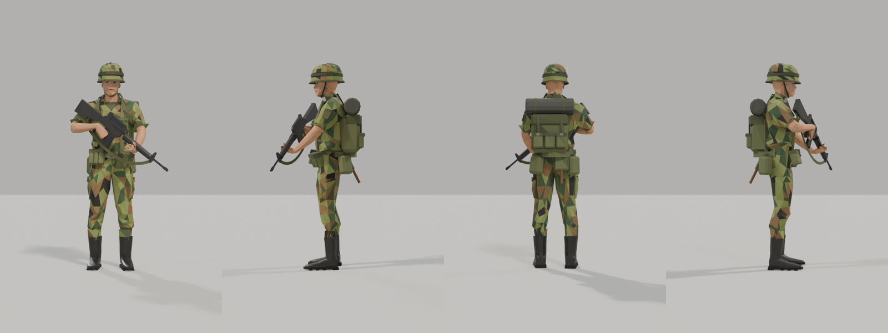
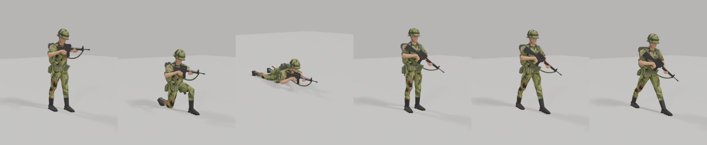

# US rifleman model

A US Army infantryman in Central Europe about 1980: M1 helmet with band, woodland BDU with rolled
sleeves, ALICE gear and pack, M16A1, laced boots. The output is
`src/Game.Godot/Assets/Infantry/US/us_rifleman.glb`. The game does not use it yet; infantry comes
later (TDD section 11). A Soviet rifleman will follow in the same style.





## Art direction

Low-poly and faceted. Each face has one flat color, with a small tone jitter per facet. There are no
textures: colors live in a face corner color attribute that glTF exports as `COLOR_0`. Camouflage is
woodland blobs from noise, nylon gear is olive drab, boots are black leather. Light ambient occlusion
is baked into the colors. Proportions come from a MakeHuman body, so the figure reads as a real
soldier from the RTS camera.

## What the model contains

- One skinned mesh, about 5,900 triangles, standing about 1.82 m with the helmet.
- The MPFB `game_engine` rig, 53 bones. The rifle is rigid on the right hand, the helmet on the head.
- Six clips: `Idle`, `AimStanding`, `AimKneeling`, `AimProne`, `Walk` and `Run`. Walk and run are
  cycles in place; the game moves the unit and scales playback to its speed. In every clip both hands
  stay on their grip of the rifle.
- Facing: -Z forward like the vehicle models (Blender +Y before export), +Y up, meters, feet on Y = 0.

## Godot import

The checked-in `.glb.import` runs `Assets/Infantry/US/import_rifleman.gd` after import. It enables
vertex colors as albedo on colored surfaces and makes all six clips loop, including the breathing
cycles in the aiming poses. These settings survive a fresh checkout and GLB regeneration; the game
does not need to repair materials or animation resources at runtime.

The normal headless client smoke test checks the imported materials, clip looping over two cycles,
and actual skeleton motion in Walk and Run. Run from the repository root:

```sh
./tools/run-client.sh --headless -- --smoke-test
```

Success includes `INFANTRY_ASSET_REGRESSIONS_OK`. This check also runs in the existing exported
client smoke tests in CI. It complements the structural GLB checks below.

## Requirements

- Blender 5.2.
- The MPFB extension 2.0.18 from extensions.blender.org.
- The MakeHuman system assets pack for MPFB (`makehuman_system_assets`), installed through the MPFB
  asset pack installer. The build uses its `male_casualsuit01` clothes, `low-poly` eyes and
  `eyebrow001`.

## Rebuild

From this folder:

```sh
blender --background --python build_us_rifleman.py -- /tmp/us_bind.blend /tmp/us_bind.glb
blender --background --python animate_us_rifleman.py -- /tmp/us_bind.blend /tmp/us_anim.blend \
  ../../../src/Game.Godot/Assets/Infantry/US/us_rifleman.glb
```

`build_us_rifleman.py` makes the body, dresses and poses it, builds the kit (helmet, webbing, pack,
rifle, boots), reduces it to the triangle budget, colors every face and binds it to the rig in the
carry pose. `animate_us_rifleman.py` authors the six clips and exports the GLB.

Preview renders (Eevee, studio backdrop):

```sh
blender --background --python preview_stills.py -- /tmp/us_bind.blend /tmp/us front,left,back,right,hero
blender --background --python preview_clips.py -- /tmp/us_anim.blend /tmp/us_clips Walk,Run
```

Checks of the exported file, standard library only:

```sh
python3 -m unittest tools/model-authoring/infantry/test_us_rifleman.py
python3 -m unittest tools/model-authoring/infantry/test_soviet_soldier.py
```

## Soviet expeditionary infantry (`soviet_rifleman.glb`, `soviet_rpg.glb`)

Modular 1980s Soviet expeditionary infantry in sand-khaki Afghanka field uniform, 6B3 body armor,
SSh-68 steel helmet with dust goggles, high laced combat boots, and role-specific loadouts:

- `src/Game.Godot/Assets/Infantry/USSR/soviet_rifleman.glb`: AK-74 (wood + bakelite mag), Lifchik
  chest rig, RD-54 assault pack with shelter-half roll, canteen, 6Kh4 bayonet, MPL-50 shovel.
- `src/Game.Godot/Assets/Infantry/USSR/soviet_rpg.glb`: RPG-7V launcher with PGO-7 optical sight
  and loaded PG-7V warhead, 3-round PG-7V rocket pack, utility pouches, canteen, bayonet, shovel.

Both models use smooth shading with angle-based sharp splits, 6 PBR material surfaces over `COLOR_0`
vertex colors (no external textures), 53 `game_engine` bones, and all six looping clips (`Idle`,
`AimStanding`, `AimKneeling`, `AimProne`, `Walk`, `Run`).

Rebuild from this folder:

```sh
blender --background --python build_soviet_soldier.py -- --role rifleman /tmp/soviet_rifleman_bind.blend
blender --background --python animate_soviet_soldier.py -- /tmp/soviet_rifleman_bind.blend /tmp/soviet_rifleman_anim.blend \
  ../../../src/Game.Godot/Assets/Infantry/USSR/soviet_rifleman.glb

blender --background --python build_soviet_soldier.py -- --role rpg /tmp/soviet_rpg_bind.blend
blender --background --python animate_soviet_soldier.py -- /tmp/soviet_rpg_bind.blend /tmp/soviet_rpg_anim.blend \
  ../../../src/Game.Godot/Assets/Infantry/USSR/soviet_rpg.glb
```

## Sources and licenses

- MPFB (GPL 3.0 or later) is used as an authoring tool only. None of its code is in this repository
  or in the game.
- The MakeHuman base mesh, body targets and the `game_engine` rig weights ship with MPFB. Their file
  headers say they were released as CC0 in September 2020.
- `male_casualsuit01`, the `low-poly` eyes and `eyebrow001` come from the MakeHuman system assets
  pack. Their `.mhclo` headers say they were released as CC0 in September 2020. Only their geometry
  is used; their textures are not.
- The helmet, webbing, pack, rifle, boots, colors and animations are built by these scripts for
  Dead Ground.
