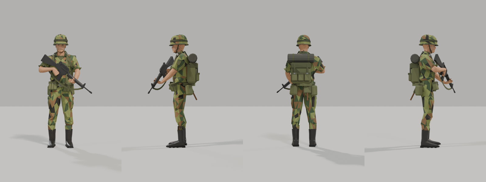
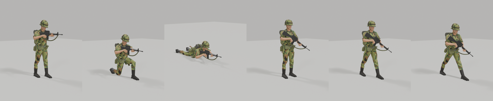

# US rifleman model

A US Army infantryman in Central Europe about 1980: M1 helmet with band, woodland BDU with rolled
sleeves, ALICE gear and pack, M16A1, laced boots. The output is
`src/Game.Godot/Assets/Infantry/US/us_rifleman.glb`. The game does not use it yet; infantry comes
later (TDD section 11). A Soviet rifleman will follow in the same style.





## Art direction

Low-poly and faceted. Each face has one flat color, with a small tone jitter per facet. There are no
textures: colors live in a face corner color attribute that glTF exports as `COLOR_0`. Camouflage is
woodland blobs from noise, nylon gear is olive drab, boots are black leather. Light ambient occlusion
is baked into the colors. Proportions come from a MakeHuman body, so the figure reads as a real
soldier from the RTS camera.

## What the model contains

- One skinned mesh, about 5,900 triangles, standing about 1.82 m with the helmet.
- The MPFB `game_engine` rig, 53 bones. The rifle is rigid on the right hand, the helmet on the head.
- Six clips: `Idle`, `AimStanding`, `AimKneeling`, `AimProne`, `Walk` and `Run`. Walk and run are
  cycles in place; the game moves the unit and scales playback to its speed. In every clip both hands
  stay on their grip of the rifle.
- Facing: -Z forward like the vehicle models (Blender +Y before export), +Y up, meters, feet on Y = 0.

## Requirements

- Blender 5.2.
- The MPFB extension 2.0.18 from extensions.blender.org.
- The MakeHuman system assets pack for MPFB (`makehuman_system_assets`), installed through the MPFB
  asset pack installer. The build uses its `male_casualsuit01` clothes, `low-poly` eyes and
  `eyebrow001`.

## Rebuild

From this folder:

```sh
blender --background --python build_us_rifleman.py -- /tmp/us_bind.blend /tmp/us_bind.glb
blender --background --python animate_us_rifleman.py -- /tmp/us_bind.blend /tmp/us_anim.blend \
  ../../../src/Game.Godot/Assets/Infantry/US/us_rifleman.glb
```

`build_us_rifleman.py` makes the body, dresses and poses it, builds the kit (helmet, webbing, pack,
rifle, boots), reduces it to the triangle budget, colors every face and binds it to the rig in the
carry pose. `animate_us_rifleman.py` authors the six clips and exports the GLB.

Preview renders (Eevee, studio backdrop):

```sh
blender --background --python preview_stills.py -- /tmp/us_bind.blend /tmp/us front,left,back,right,hero
blender --background --python preview_clips.py -- /tmp/us_anim.blend /tmp/us_clips Walk,Run
```

Checks of the exported file, standard library only:

```sh
python3 -m unittest tools/model-authoring/infantry/test_us_rifleman.py
```

## Sources and licenses

- MPFB (GPL 3.0 or later) is used as an authoring tool only. None of its code is in this repository
  or in the game.
- The MakeHuman base mesh, body targets and the `game_engine` rig weights ship with MPFB. Their file
  headers say they were released as CC0 in September 2020.
- `male_casualsuit01`, the `low-poly` eyes and `eyebrow001` come from the MakeHuman system assets
  pack. Their `.mhclo` headers say they were released as CC0 in September 2020. Only their geometry
  is used; their textures are not.
- The helmet, webbing, pack, rifle, boots, colors and animations are built by these scripts for
  Dead Ground.
